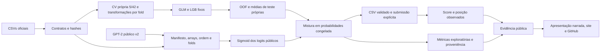

# Requisitos e arquitetura

## Objetivo e contratos

Participar de uma competição aberta com intenção de vencer, construir uma solução explicável e publicar código, vídeo e estudo de caso como portfólio. A atividade de Redes Neurais é parte desse objetivo. A liderança continua uma meta não alcançada.

O projeto exige regras conferidas, treinamento neural próprio real, comparação de alternativas, previsões submetidas de fato e posição observada. Scores locais, score público e ranking final são registros distintos. Nenhuma flag de evidência é inferida de um build, teste sintético ou arquivo gerado.

A apresentação cobre problema, proposta, construção, matemática, arquiteturas, experimentos, códigos e ranking. Cada slide complexo deve ser seguido imediatamente por explicação simples com exemplo cotidiano. Narração e legendas são em português, com duração determinada pela cobertura.

## Protocolo operacional híbrido

A [receita pública](../notebooks/hybrid-recipe.json) fixa CV estratificada com cinco folds, shuffle e seed 42 sobre as 699.960 linhas. Cada treino próprio usa quatro folds; a OOF é calculada somente no fold excluído. No teste, cada família própria usa a média das probabilidades dos cinco modelos. O pré-processamento aprendido fica dentro de cada treino; target encoding usa cinco partições internas.

| Componente | Implementação e parâmetros usados | Peso efetivo |
| --- | --- | --- |
| GLM próprio | Logística com logits de target encoding, one-hot e escala; Newton-Cholesky, C=0,3, suavização 50 | 56,25% |
| LightGBM próprio | 1.438 árvores fixas, 4 folhas, taxa 0,04, L2=5, mínimo de 100 exemplos por folha, suavização 20; sem early stopping | 18,75% |
| GPT-2 target-first público | Previsões da versão 2, importadas e convertidas de logits para probabilidades; treinamento do autor externo | 25% |

Os atributos `value_digits` combinam entradas originais com logs, ciclos, razão e chaves de valores/dígitos. São hipóteses sobre os dados sintéticos, não regras causais de fraude bancária. ID e alvo são excluídos das entradas.

A composição é `0.75 × (0.75 × GLM + 0.25 × LGB) + 0.25 × GPT2`, em probabilidades. Os parâmetros próprios permaneceram congelados. A grade exploratória de 10/25/50/75% do componente público foi medida somente em OOF alinhada; 25% melhorou os cinco folds e ficou praticamente empatado com 50%. A escolha mantém maior contribuição própria para o mesmo ganho observado. A OOF híbrida registrada é 0.95125863; ela foi usada na seleção e não é avaliação independente.

## Origem externa e limites de atribuição

As [previsões GPT-2 v2 de Masaya Kawamata](https://www.kaggle.com/datasets/masayakawamata/s6e11-gpt2-target-first-oof/versions/2) são CC BY 4.0. O [código de treino MIT](https://github.com/Matapanino/s6e11-gpt2-target-first/tree/8446fb73c11583df4f7006aa08fa34472249b318) e os créditos a Chris Deotte, Borisov et al./GReaT e uditjain13 são preservados. A [auditoria pública](../evidence/external-gpt2.json) e a receita registram versão, hashes e proveniência.

O importador não executa código externo: valida a release aprovada, bytes dos CSVs/arrays, formas, tipos, valores finitos, ordem original e fold_ids exatos de cinco folds com seed 42. O manifesto declara 10 ordens de atributos, log-sum-exp por rótulo e prior do treino do fold. Cada OOF pública vem do modelo que excluiu aquele fold; no teste, o autor faz média de cinco logits, seguida de sigmoid na importação. O blend posterior usa probabilidades.

`external_components` registra autoria, licenças, URLs, commit, versão 2, conversão, peso efetivo e `trained_by_us=false`. A rede pública não é apresentada como treinamento nosso. As MLPs próprias foram treinadas e avaliadas localmente; não trouxeram ganho consistente à composição própria e permanecem comparações históricas reais.

## Histórico separado: holdout e refits próprios

A primeira etapa reservou 15% dos rótulos com seed 2026 e usou três folds nos 85% de desenvolvimento. Depois de congelar a composição própria 75/25, a avaliação única da reserva usou a média dos três checkpoints de cada família. Esse resultado pertence ao protocolo de desenvolvimento histórico.

Em seguida, os refits únicos `final-glm` e `final-lgbm` utilizaram todos os 699.960 rótulos, sem nova OOF ou early stopping. A mediana das árvores escolhidas no desenvolvimento fixou 1.438 árvores. A própria `final-blend`, ligada à submissão 58437018, registra `phase=full_data_refit`, `roc_auc=null` e a referência de desenvolvimento separada em `selection`.

A híbrida atual 58438450 usa `explore5-glm` e `explore5-lgbm`, com médias de teste dos cinco modelos por família, mais GPT-2 v2. Ela não usa aqueles refits únicos. Todos os rótulos, inclusive a antiga reserva, participam desta etapa; portanto `phase=exploratory_full_data_cv`, `holdout_fraction=0` e `independent_holdout=false`. O holdout anterior não é reavaliado nem atribuído ao híbrido. Seu relatório, ledger e artefatos foram preservados.

## Estrutura e rastreabilidade

| Local | Responsabilidade |
| --- | --- |
| `src/fraudlab/data.py`, `splits.py`, `features.py` | Contratos, hashes, divisões e transformações determinísticas |
| `models.py`, `experiment.py` | Modelos, ajustes por fold, OOF, checkpoints, médias e metadados |
| `offset.py`, `frequency.py` | Experimentos opcionais: árvores residuais sobre o GLM e contagens por categoria ajustadas no treino |
| `external.py` | Importação da única release pública aprovada e atribuição |
| `holdout.py`, `refit.py` | Avaliação reservada e refits do protocolo próprio histórico |
| `notebooks/hybrid-recipe.json`, `scripts/kaggle_notebook.py` | Receita portátil e exportação offline da fonte Git fixada |
| `evidence/`, `presentation/`, `site/` | Fatos públicos, conteúdo didático, mídia e estudo de caso |

O núcleo é uma CLI Python sobre arquivos locais. Não há banco de dados ou servidor de treinamento. `evidence/public.json` concentra os fatos publicados; o README mantém o acompanhamento único do trabalho. Dados, credenciais e artefatos privados ficam fora do Git.

As extensões de 17/11 são opcionais: `--glm-spline-knots`, `--glm-frequency` e
`--feature-set paired_digits`. Seus planos e resultados ficam em `evidence/`.
Elas não atingiram o critério de promoção; a receita operacional híbrida acima
permanece a mesma. Os quatro pares usam bins fixos, sem seleção por rótulos;
as contagens são aprendidas só no treino de cada fold. O offset persiste GLM e
árvores juntos e soma explicitamente as margens antes da sigmoid.

O notebook canônico é um único arquivo, exportado do SHA `30dc7eb723e4cf31291bb075ed6c0d943557264c` com hashes de cada módulo e sem instalação remota. A versão 3 foi publicada por Save sem execução, com os inputs anexados e internet desativada. Isso compartilha o código; não comprova treino naquele notebook. O gerador preserva acesso ao protocolo anterior por `--protocol` e pela história Git.

## Critérios de verificação

- Dados e arquivo: alvo binário; IDs únicos, completos e na ordem exigida; probabilidades finitas entre 0 e 1.
- Modelagem: exclusão do fold avaliado, transformações aprendidas só no treino, alinhamento exato entre OOFs, parâmetros/versões/hashes registrados e escopo da validação explícito.
- Submissão: arquivo exato identificado por SHA256, processamento e posição conferidos na plataforma. Ranking público é provisório.
- Apresentação: fórmulas e símbolos legíveis, pares complexo/simples imediatos, código real, autoria externa explícita e narração/legendas sincronizadas.
- Publicação: arquivos públicos permitidos, site responsivo, links reais e verificação do ambiente hospedado separada do build local.

O comando de testes é `python -m pytest tests presentation site/test_build.py -q`. Testes sintéticos e checagens automáticas validam software; não comprovam competitividade, publicação ou que uma pessoa assistiu ao vídeo inteiro.
