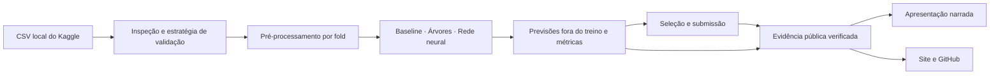

# Requisitos e arquitetura

## Objetivo

Participar de uma competição aberta do Kaggle com intenção de vencer, construir uma solução explicável e publicar o trabalho como portfólio. A atividade universitária de Redes Neurais é parte desse objetivo.

## Contratos

1. Confirmar as regras da competição escolhida antes de baixar, compartilhar ou submeter conteúdo afetado por elas. Se estiver encerrada, selecionar outra vigente e reavaliar os contratos.
2. Treinar e avaliar uma rede neural de fato. Comparar alternativas adequadas aos dados; informar quando a rede não melhorar a solução final. Não disfarçar outro método como rede neural.
3. Medir generalização com divisões coerentes com tempo, grupos e duplicatas. Separar resultados locais dos resultados de Kaggle. Não escolher o modelo somente pela pontuação pública.
4. Registrar cada experimento, o arquivo exato submetido e a resposta da plataforma. Nunca preencher ranking ou scores não observados.
5. Explicar problema, solução, implementação, matemática, arquiteturas, experimentos, códigos e posição. Cada slide complexo deve ser seguido por um slide simples com exemplo cotidiano. Narração e legendas em português; duração determinada pela cobertura, sem limite arbitrário.
6. Publicar o código em `aikolopes-og` e disponibilizar um estudo de caso hospedado, com limites e evidências visíveis.

## Fluxo

O núcleo Python lê arquivos locais. Não há servidor para treinar nem banco de dados. O site é estático. `evidence/public.json` contém somente os fatos que podem ser publicados; pontuações e posições desconhecidas permanecem nulas. As ferramentas de apresentação e publicação consomem esse contrato.

## Critérios de validação

- Contratos: alvo binário, IDs íntegros, probabilidade finita entre zero e um, cobertura e ordem dos IDs exigidos na submissão.
- Modelagem: divisões sem sobreposição, transformações sem acesso ao fold de validação, métrica ROC-AUC, estabilidade entre folds e rastreabilidade.
- Apresentação: fórmula e símbolos legíveis, par complexo/simples imediato, conteúdo fiel aos experimentos, narração sincronizada e revisão do arquivo exportado.
- Publicação: revisão dos arquivos que sairão da máquina, CI, site responsivo e links reais. Publicação confirmada e fluxo operacional verificado são evidências distintas.

Testes pequenos com dados sintéticos validam software. Não provam desempenho na competição.
