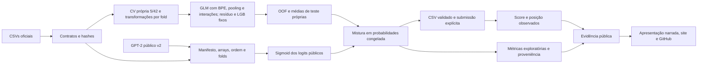

# Requisitos e arquitetura

## Objetivo e contratos

Participar de uma competição aberta com intenção de vencer, construir uma solução explicável e publicar código, vídeo e estudo de caso como portfólio. A atividade de Redes Neurais é parte desse objetivo. A liderança continua uma meta não alcançada.

O projeto exige regras conferidas, treinamento neural próprio real, comparação de alternativas, previsões submetidas de fato e posição observada. Scores locais, score público e ranking final são registros distintos. Nenhuma flag de evidência é inferida de um build, teste sintético ou arquivo gerado.

A apresentação cobre problema, proposta, construção, matemática, arquiteturas, experimentos, códigos e ranking. Cada slide complexo deve ser seguido imediatamente por explicação simples com exemplo cotidiano. Narração e legendas são em português, com duração determinada pela cobertura.

## Protocolo atual: seleção R18 e refit R20

O [plano R18](../evidence/round18-plan.json) fixa CV estratificada com cinco folds, shuffle e seed 42 sobre as 699.960 linhas. Cada treino próprio usa quatro folds; a OOF é calculada somente no fold excluído. No teste, cada família própria usa a média das probabilidades dos cinco modelos. Target encoding e pooling têm cinco partições internas; mapas, frequência e escalas são ajustados no treino externo. Fonte: commit [8a1c7fd](https://github.com/aikolopes-DS/fraudlab/tree/8a1c7fd141b43e41b0d43e3a07b0c5ad0bf41ae5).

| Componente | Implementação e parâmetros usados | Peso efetivo |
| --- | --- | --- |
| Offset próprio | GLM Newton-Cholesky, C=0,3, target encoding 5/50, one-hot e escala; `joint_bpe`, frequência por fold e 16 taxas hierárquicas. Resíduo: 1.000 árvores, 4 folhas, taxa 0,03, L2=5, mínimo de 100 exemplos por folha | 56,25% |
| LightGBM próprio | `value_digits`, 1.438 árvores fixas, 4 folhas, taxa 0,04, L2=5, mínimo de 100 exemplos por folha, suavização 20; sem early stopping | 18,75% |
| GPT-2 target-first público | Previsões da versão 2, importadas e convertidas de logits para probabilidades; treinamento do autor externo | 25% |

`bpe_digits` estende `value_digits` — entradas originais, logs, ciclos, razão e chaves de valores/dígitos — com seis chaves do tokenizer GPT-2 para valor e saldo. `joint_bpe` acrescenta oito interações fixas. O pooling compartilha taxas entre campos relacionados com suavizações 50/2.000/200; cada linha recebe estatísticas de outros subconjuntos internos. São 92 atributos antes do pré-processamento e 223 entradas codificadas. Testamos padrões sintéticos, sem afirmar regras causais bancárias. ID e alvo ficam excluídos.

A composição é `0.5625 × offset + 0.1875 × LGB + 0.25 × GPT2`, em probabilidades. Dentro do offset: `sigmoid(margem GLM + margem residual)`. Os dois termos usam a mesma matriz de treino com codificação supervisionada internamente cruzada e são salvos juntos. A seleção R18 não usa early stopping externo. No [refit R20](../evidence/round20-plan.json), ambos os componentes próprios são reaprendidos com todos os 699.960 rótulos, preservando configurações e pesos da mistura. O GPT-2 externo permanece igual. Esses refits não produzem uma nova OOF; a nota local continua atribuída à seleção R18.

A [OOF R18](../evidence/round18-results.json) é **0,9516524825255244**, ganho de 0,0001603443 sobre R10 e melhora nos cinco folds. Planos, pesos e critério precederam o treino; a [auditoria independente](../evidence/round18-verification.json) recalculou OOF, misturas e checkpoints. A CV participou da seleção e não é avaliação independente. A [submissão 58481744](../evidence/round18-public.json) obteve score público **0,95141**, posição **714/2.125**, observada em **17/11/2026 às 20h53min43s UTC**. A R10 anterior havia obtido 0,95134.

O arquivo atual [R20, submissão 58483010](../evidence/round20-public.json), recebeu **0,95162**, posição **657/2.126** em **17/11/2026 às 21h59min16s UTC**. A [auditoria R20](../evidence/round20-verification.json) reproduziu 1.024 previsões de cada checkpoint e verificou a composição nas 299.984 linhas de teste; o CSV remoto completo tem o mesmo SHA-256 do local. A classificação continua provisória e as primeiras posições não foram alcançadas.

## Origem externa e limites de atribuição

As [previsões GPT-2 v2 de Masaya Kawamata](https://www.kaggle.com/datasets/masayakawamata/s6e11-gpt2-target-first-oof/versions/2) são CC BY 4.0. O [código de treino MIT](https://github.com/Matapanino/s6e11-gpt2-target-first/tree/8446fb73c11583df4f7006aa08fa34472249b318) e os créditos a Chris Deotte, Borisov et al./GReaT e uditjain13 são preservados. A [auditoria pública](../evidence/external-gpt2.json) e a receita registram versão, hashes e proveniência.

O importador não executa código externo: valida a release aprovada, bytes dos CSVs/arrays, formas, tipos, valores finitos, ordem original e fold_ids exatos de cinco folds com seed 42. O manifesto declara 10 ordens de atributos, log-sum-exp por rótulo e prior do treino do fold. Cada OOF pública vem do modelo que excluiu aquele fold; no teste, o autor faz média de cinco logits, seguida de sigmoid na importação. O blend posterior usa probabilidades.

`external_components` registra autoria, licenças, URLs, commit, versão 2, conversão, peso efetivo e `trained_by_us=false`. A rede pública não é apresentada como treinamento nosso. MLPs e TabM próprias foram treinadas e comparadas; não justificaram sua inclusão na composição selecionada e permanecem experimentos reais documentados.

## Histórico separado: holdout e refits próprios

A primeira etapa reservou 15% dos rótulos com seed 2026 e usou três folds nos 85% de desenvolvimento. Depois de congelar a composição própria 75/25, a avaliação única da reserva usou a média dos três checkpoints de cada família. Esse resultado pertence ao protocolo de desenvolvimento histórico.

Em seguida, os refits únicos `final-glm` e `final-lgbm` utilizaram todos os 699.960 rótulos, sem nova OOF ou early stopping. A mediana das árvores escolhidas no desenvolvimento fixou 1.438 árvores. A própria `final-blend`, ligada à submissão 58437018, registra `phase=full_data_refit`, `roc_auc=null` e a referência de desenvolvimento separada em `selection`.

A híbrida v0.1, submissão 58438450, usava `explore5-glm` e `explore5-lgbm` mais GPT-2 v2, com OOF 0,95125863. Sua [receita](../notebooks/hybrid-recipe.json) permanece como baseline histórica. A R10 substitui seu GLM pelo offset com BPE e frequência, mantendo o LightGBM, o componente externo e os pesos efetivos. Ambas usam médias de cinco modelos próprios, sem os refits únicos anteriores.

Todos os rótulos, inclusive a antiga reserva, participam da CV atual: `phase=exploratory_full_data_cv`, `holdout_fraction=0` e `independent_holdout=false`. O holdout anterior não é reavaliado nem atribuído às rodadas atuais. R12–R17 e R19 falharam em seus critérios de promoção. Após falta de memória, a recuperação R17 preservou três checkpoints completos e treinou apenas os dois folds restantes, sem mudar o modelo; o tempo original completo permanece indisponível.

## Estrutura e rastreabilidade

| Local | Responsabilidade |
| --- | --- |
| `src/fraudlab/data.py`, `splits.py`, `features.py`, `bpe.py` | Contratos, hashes, divisões e transformações determinísticas |
| `models.py`, `experiment.py` | Modelos, ajustes por fold, OOF, checkpoints, médias e metadados |
| `offset.py`, `frequency.py` | Componente R10: árvores residuais sobre o GLM e contagens por categoria ajustadas no treino |
| `tabm.py` e MLP em `models.py` | Redes próprias treinadas como comparações |
| `external.py` | Importação da única release pública aprovada e atribuição |
| `holdout.py`, `refit.py` | Avaliação reservada e refits do protocolo próprio histórico |
| `notebooks/hybrid-recipe.json`, `scripts/kaggle_notebook.py` | Receita e exportação da baseline v0.1; o notebook V5 contextualiza a R10 em Markdown |
| `evidence/`, `presentation/`, `site/` | Fatos públicos, conteúdo didático, mídia e estudo de caso |

O núcleo é uma CLI Python sobre arquivos locais. Não há banco de dados ou servidor de treinamento. `evidence/public.json` concentra os fatos publicados; o README mantém o acompanhamento único do trabalho. Dados, credenciais e artefatos privados ficam fora do Git.

Os planos e resultados das ablações ficam em `evidence/`. Splines, pares, one-hot esparso e TabM não foram promovidos. Frequência e BPE foram integrados à R10 com o offset após a comparação prospectiva. A R9 teve [envio exploratório em exceção declarada](../evidence/public-evaluation-results.json): melhorou apenas três folds e não passou no critério original. A R10 passou no seu critério sem essa exceção. A [R11](../evidence/round11-results.json), com 2.000 árvores residuais, ficou abaixo da R10 na OOF e não foi submetida.

O [notebook V5](https://www.kaggle.com/code/aikoog/fraudlab-reproducible-neural-fraud-detection) mantém células executáveis da baseline v0.1, fonte `30dc7eb723e4cf31291bb075ed6c0d943557264c`, e Markdown sobre R10. Foi salvo sem execução na nuvem; 22 células remotas conferem com as locais, sem contagens de execução ou outputs. Ele não executou R18 na nuvem. A fonte atual está no [GitHub](https://github.com/aikolopes-DS/fraudlab). A [mídia v0.3, 139 slides e 54min51s](https://github.com/aikolopes-DS/fraudlab/releases/tag/v0.3.0), documenta o marco R10. A revisão v0.4 está em montagem, ainda não publicada.

## Critérios de verificação

- Dados e arquivo: alvo binário; IDs únicos, completos e na ordem exigida; probabilidades finitas entre 0 e 1.
- Modelagem: exclusão do fold avaliado, transformações aprendidas só no treino, alinhamento exato entre OOFs, parâmetros/versões/hashes registrados e escopo da validação explícito.
- Submissão: arquivo exato identificado por SHA256, processamento e posição conferidos na plataforma. Ranking público é provisório.
- Apresentação: fórmulas e símbolos legíveis, pares complexo/simples imediatos, código real, autoria externa explícita e narração/legendas sincronizadas.
- Publicação: arquivos públicos permitidos, site responsivo, links reais e verificação do ambiente hospedado separada do build local.

O comando de testes é `python -m pytest tests presentation site/test_build.py -q`. Testes sintéticos e checagens automáticas validam software; não comprovam competitividade, publicação ou que uma pessoa assistiu ao vídeo inteiro.
